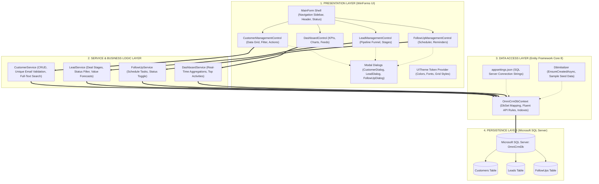
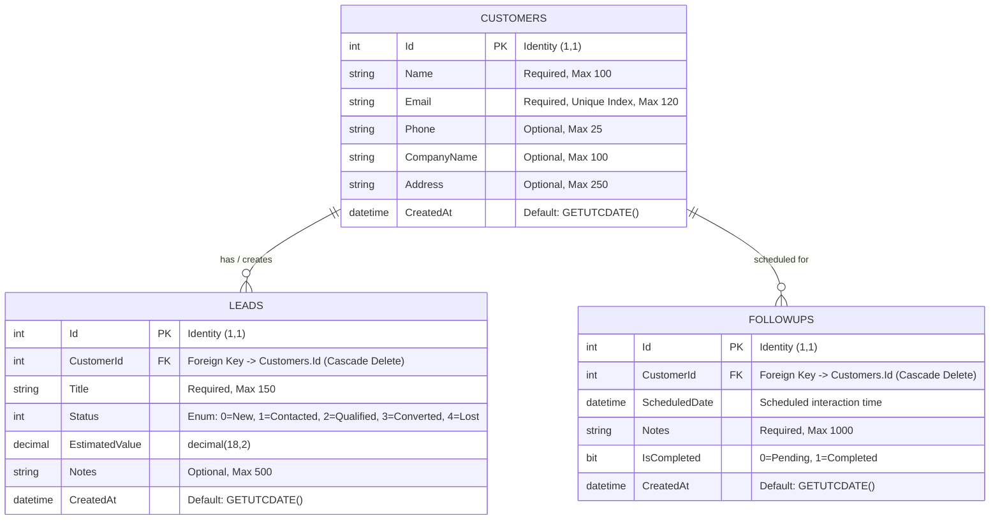
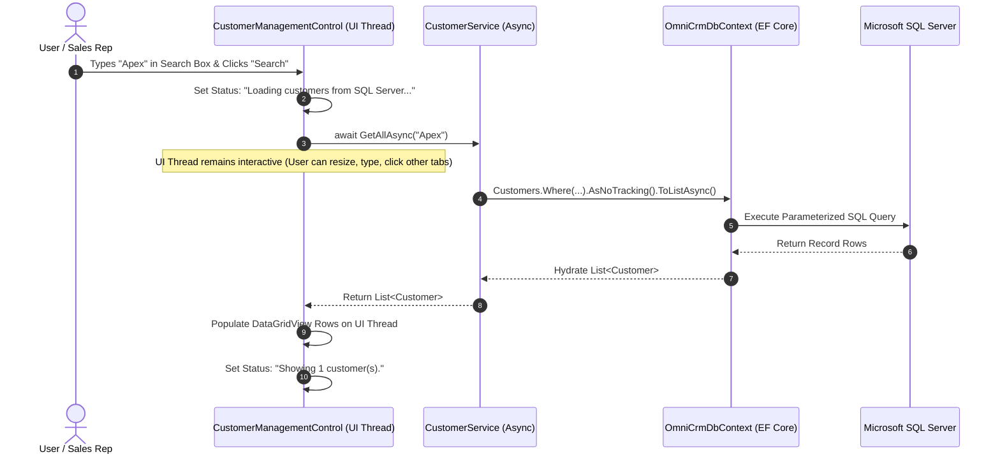

# OmniCRM — System Architecture & Design Documentation

This document presents the detailed architectural blueprint of the **OmniCRM** enterprise application, including multi-tier architectural diagrams, Entity-Relationship (ER) schemas, component navigation hierarchies, and asynchronous data flows.

---

## 1. High-Level Multi-Tier Architecture

OmniCRM is architected as a clean, decoupled **Four-Tier Desktop System**:

---

## 2. Entity-Relationship Diagram (ERD)

The database schema enforces strict relational modeling, 1-to-Many cardinality, and cascading referential integrity:

---

## 3. Asynchronous Execution Lifecycle

To guarantee that the desktop user interface remains fluid and non-blocking, all database operations employ the **Task-based Asynchronous Pattern (TAP)**:

---

## 4. Layer-by-Layer Architectural Breakdown

### 1. Presentation Layer (Desktop UI)
* **Single Form Shell (`MainForm`):** Acts as the parent container. Contains the dark sidebar navigation, dynamic section title, and real-time database connection status badge.
* **Modular View Injection:** Instead of launching multiple separate windows, `MainForm` swaps lightweight `UserControl` instances (`DashboardControl`, `CustomerManagementControl`, `LeadManagementControl`, `FollowUpManagementControl`) into a central panel.
* **Design System (`UITheme`):** Centralizes colors (Dark Navy `#0F172A`, Royal Indigo `#2563EB`, Canvas `#F8FAFC`), fonts, and grid rendering to maintain a consistent enterprise aesthetic.

### 2. Service Layer (Domain Logic)
* Encapsulates all query composition, business rules, calculations, and data validations.
* **Email Uniqueness:** Prevents duplicate accounts by querying existing emails before saving.
* **Status Filtering & Valuation:** Sums active deals while excluding discarded leads.

### 3. Data Access Layer (Entity Framework Core)
* **`OmniCrmDbContext`:** Manages entity sets, connection lifetimes, and mapping rules.
* **Performance Optimizations:** Queries that are read-only use `.AsNoTracking()` to reduce memory footprint and avoid change-tracker overhead.
* **Resilient Startup (`DbInitializer`):** Automatically initializes the database catalog and seeds enterprise demonstration records if tables are empty.

### 4. Database Layer (SQL Server)
* Relational tables with clustered primary keys, foreign key constraints with cascade deletes, and non-clustered indexes on search/filter columns (`Email`, `Name`, `Status`, `ScheduledDate`).
